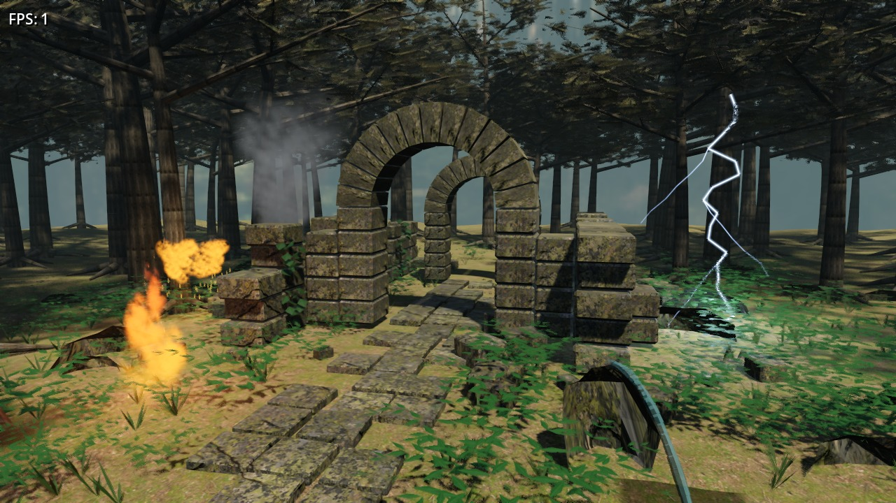

# Forest Ruins — Godot 4

Godot rendering of the same deterministic forest-ruins geometry used by [filament-test](https://github.com/edward9s/filament-test). The stone arches, forest, path, camera target, and source Poly Haven textures are carried across; lighting and tone mapping are engine-specific and cannot be pixel identical.



Actual 1280×720 Vulkan render on Linux llvmpipe. The displayed FPS is software rendering performance, not an Android measurement.

## Prepare scene

Requires Linux x86-64, Python 3.11+, `g++`, `curl`, `tar`, Pillow, and Godot 4.7.2. Generated assets are deliberately excluded from git.

```sh
python3 -m pip install Pillow==11.3.0
python3 scripts/prepare_scene.py
# Open project.godot in Godot 4.7.2, or run:
godot --headless --path . --editor --import --quit
```

The preparation script downloads SHA-256-verified CC0 Poly Haven imagery and the matching Filament 1.78.1 host SDK headers, compiles the vendored `Geometry.cpp` from filament-test's effects branch (`4d884ac5`), with the outward-facing round-rock winding fix, and exports its deterministic 232 spatial/material batches into a textured glTF binary. This includes the spring rock and vegetation clearance around the flowing water. No native Filament code or SDL is shipped in the APK.

## Android

Use **Actions → Android test build → Run workflow** to generate a signed arm64 APK, published to the rolling `test-build` prerelease. The workflow is manual-only and uses the repository's existing `KEYSTORE_BASE64`, `STORE_PASSWORD`, `KEY_ALIAS`, `KEY_PASSWORD` secrets. It never generates a signing identity. Build outputs replace the existing test prerelease rather than creating a new release per run. Package: `com.edward9s.godotforesttest`.

## Scene and controls

The same generated terrain, stones, two arches, surrounding trees, bark branches, canopy quads, ferns and ivy, and Poly Haven 1K PBR maps/HDRI are used. Sun direction matches Filament (`[-0.32,-0.82,-0.47]`); linear source light colors are converted to Godot’s sRGB light properties. Camera orbit: one-finger drag or left mouse; pinch or mouse wheel zoom. The top-left FPS button shows the active renderer, actual 3D resolution percentage, render CPU/GPU time and effect-update CPU time. Tap it to switch between Auto resolution and Native 100%. The timing values are separate measurements, not total CPU frame time.

Desktop uses **Forward+** for SSAO, TAA and PCSS sun shadows. Android uses **Mobile**, with 2× MSAA and PCF shadows. SSAO, TAA and angular PCSS are explicitly disabled when the active renderer is Mobile; this is a visible quality tradeoff, not equivalent output. On Forward+, SSAO uses the source's 0.75 m radius and 1.2 power, and TAA combines with 2× MSAA. Both renderers use the HDRI for diffuse ambient lighting and filtered reflections. Four shadow cascades cover 48 m using a 4096 atlas, including the Android override. Both renderers blend cascade transitions; shadow pancaking is disabled for the tall batched tree crowns. Split distances are 12%, 38% and 65%. Bias is explicitly 0.03 and normal bias 0.35, avoiding the default large normal offset that loses contact shadows on small leaves. On Forward+, PCSS uses a 1.06° angular diameter corresponding to the source's 0.53° solar radius. Shadow filter quality remains 2 on both platforms.

Imported ground, stone and bark materials explicitly enable the generator's linear vertex colors. Godot 4.7.2 leaves this material flag off after glTF import, losing the source tints and surface variation.

All original canopy and leaf wind deformation remains enabled in the color and shadow passes. Foliage casts double-sided shadows with a 0.12 m culling margin for wind. Godot handles back-face normals for the double-sided shaders; a modest backlight term approximates the source's leaf transmission. Sky energy (0.50), ambient multiplier (0.18), warm sunlight (1.1), ACES tone mapping and fixed camera exposure (0.65) aim for a quieter forest rather than a washed-out clearing. Glow and distance fog remain enabled. Android still requires Vulkan. Retest stability and compare image quality on the physical device; a software Vulkan test cannot validate an Adreno driver.

## Android Vulkan crash

The supplied SM-X700 log reports compute-pipeline creation failure (`VkResult -13`), followed by Vulkan device loss and an intentional Godot SIGTRAP after 26 seconds. The log identifies the rendering failure but does not name the failed shader or prove the cause of device loss. Upstream [#124406](https://github.com/godotengine/godot/issues/124406) reports a similar startup error on another Android 16 Adreno device with Godot 4.7.2, and reports that Mobile avoids it; that report remains unconfirmed by maintainers and does not prove an identical defect on this tablet.

Version 0.1.1 switches Android back to its original Mobile rendering path, avoiding Forward+-only internal pipelines. Desktop Forward+ remains available. All five effects, animated foliage, source geometry, material AO/normal maps, 4096 shadow atlas, four shadow cascades, HDRI, exposure, glow and fog remain. The FPS overlay identifies the active renderer. The device owner confirmed that version 0.1.1 runs after this change. This is a renderer workaround, not an engine/driver fix or a claim of matching Filament quality.

Use **Actions → Vulkan tests → Run workflow** to check both Vulkan renderers, with scene/material checks, 3,600 effect frames, 180 full-scene frames, stable buffer identities, bounded memory and GPU readback. This separate manual workflow runs independently of **Android test build**. It prepares and imports its own scene assets and does not export or publish an APK. Android builds retain the quick geometry and headless checks; release signing uses the configured repository secrets.

## Foliage shadows and water (0.1.4)

The shaders previously flipped back-face normals after Godot had already flipped them, reversing the correction. This duplicate flip is removed from canopy, leaves and water. The reported upper-crown shadow shimmer is also addressed in two places: directional shadow
pancaking is disabled for the tall spatial batches, and cascade transitions are blended on
Mobile as well as Forward+. Pancaking can distort large casters at the shadow-frustum edge;
unblended cascades can change the shadow abruptly as the camera or silhouette moves. These
are targeted candidate fixes, not a confirmed diagnosis of the tablet artifact. The 4096
atlas, four cascades, 48 m range, double-sided leaf shadows and full wind remain. Blending
adds shadow samples at cascade transitions; device FPS and residual aliasing need validation.

The shallow sheet previously used a fixed 0.62 opacity over a dark albedo, with only the
HDR panorama for reflections. Water now fades toward clearer transparency when viewed from
above, becomes more reflective at grazing angles, softens all four sheet edges, and uses the
ripple normal for its view-angle calculation. Premultiplied blending attenuates the water tint without multiplying away the reflected light. The duplicate back-face normal flip is removed and
roughness is 0.18. Geometry, flow timing, foam, jet and splash counts remain unchanged.

A single `ReflectionProbe` captures the surrounding forest once over its initial update
frames. The probe affects only water (render layer 2); its capture includes forest layer 1
and excludes water and effect particles (layer 3, bit mask 4). Masonry keeps its existing
lighting and environment reflections. The probe uses no extra shadow maps and does not
refresh for moving leaves or effect flashes: this is a static local reflection, not a live
planar reflection. It adds startup rendering and a reflection lookup without a recurring
six-view capture each frame. No screen-space reflections or extra downloads are introduced.

## GPU workload (0.1.3)

Ground, stone and bark now share three `ORMMaterial3D` resources. AO and roughness use the same source channels, but a single ORM fetch replaces the separate AO/roughness/metallic texture fetches in `StandardMaterial3D`. The glTF preparation step bakes the existing zero metallic factor into B and stores the ORM image as lossless PNG; decoded R/G values are unchanged. Albedo, normal maps, linear vertex tints, UV transforms, sampler settings and material culling are preserved.

The external canopy PNG has explicit mipmap generation and VRAM compression settings before editor import. Custom-shader textures no longer depend on automatic 3D detection to receive those settings. Texture resolution, alpha-scissor threshold and wind deformation remain unchanged.

Fire, explosion, spray, lightning and smoke each compile their own variant of a shared shader include. The effect kind is a preprocessor constant, removing the other effects' branches from each fragment program. Particle equations, noise, color, opacity, counts and animation timing remain unchanged.

Mobile retains the 4096 shadow atlas, all four cascades, 48 m range, double-sided foliage shadows and filter quality 2. Version 0.1.3 disabled cascade transition blending on Mobile to reduce shadow lookups. Version 0.1.4 restores it to smooth moving foliage across cascade boundaries; the ORM, mipmap and particle improvements remain. MSAA, HDRI, glow, fog and all five effects remain enabled.

Validation of the particle fragment math in a Mesa OpenGL ES harness covered 120 before/after image comparisons at 128×128, with zero RGBA8 pixel difference. This isolates the fragment code; it is not a complete Godot render or an Android FPS measurement. Material-channel packing was checked independently. The owner subsequently measured 30–45 FPS for version 0.1.3. Version 0.1.4 shadow and water changes require a fresh tablet check.

## Performance (0.1.2)

Each effect quad now shares four vertices across the same two indexed triangles: 2,332 vertices instead of 3,498, with all 583 quads / 1,166 triangles retained. Maximum dynamic position/normal/attribute uploads fall from 96,624 to 64,416 bytes per update, excluding the index buffers uploaded once. Terrain heights, jet paths, ring directions and UVs are cached. The water sheet evaluates each of its 91 shared points once per update, rather than 288 times. Explosion and lightning batches stop updating/drawing only when their entire batch falls below the fragment shader's existing alpha cutoff; they resume from the current timeline when visible again. A zero-energy lightning light is also hidden. Source shaders, all five effects, vegetation wind, geometry density, textures, MSAA and shadow quality are retained.

On the same Linux host and official Godot 4.7.2, two alternating before/after headless benchmark pairs measured per-run medians of **2.82–2.87 ms → 1.41–1.45 ms per effect update**, approximately 50% less effect CPU time. Each run measures five complete 324-update (5.4-second) cycles after warm-up. This is not a whole-frame speedup, GPU benchmark or SM-X700 FPS estimate. Expanding the indexed buffers and comparing 24 time/view samples against the previous implementation preserved every visible position, color, UV, normal and tangent; the maximum measured position difference was zero.

Filament's reference enables dynamic resolution at 65–100% per axis. Android now uses the same range, adapting to measured GPU time around a 60 FPS budget. A 0.65 scale draws 42.25% as many 3D pixels and reduces sharpness; the HUD stays at native resolution. The controller uses startup/resize settling intervals, minimum sample counts and separate down/up thresholds. A CPU/VSync slowdown alone does not lower resolution, and a GPU timer reporting zero leaves the scale unchanged. Desktop starts in Native mode. Tap the FPS button for **Native 100%** when comparing image quality or benchmarking at equal resolution. Shadow maps and effect counts do not scale down. Physical-device FPS and visual comparison remain necessary.

## Effects

The five displays follow [filament-test PR #4](https://github.com/edward9s/filament-test/pull/4), which was still unmerged when this port was made:

| Display | Position (x, z) | Animation |
| --- | --- | --- |
| Fire | −3.2, 3.1 | Continuous flames, rising embers, flickering local light |
| Explosion | −6.3, −1.6 | Expanding fireball and ballistic sparks every 5.4 seconds |
| Water | 3.5, 3.5 | Raised spring, tubular jet, shallow flowing sheet and splashes |
| Lightning | 6.3, −3.2 | Branching double strike every 4.8 seconds with local flash |
| Smoke | −7.0, −6.2 | Continuous drifting dense column |

`scripts/effects.gd` ports the deterministic seeds, equations, particle counts and sites. Six persistent indexed `ArrayMesh` batches total 583 quads / 1,166 triangles. `scripts/effect_batch.gd` allocates each surface once and updates vertex/attribute buffer regions in place. Animation never clears or recreates GPU surfaces. Fixed bounds cover the entire motion; water normal and tangent buffers update with its geometry. Transparent puffs are sorted back to front for the orbit camera; water uses moving tangent normals, foam, view-dependent transparency and a one-time capture of the surrounding forest for reflections. Fire, explosion and lightning animate three nearby point lights. Emission and light energies are calibrated in Godot units. No particle textures, physics or extra asset downloads are required.

Validate after generating and importing assets:

```sh
python3 scripts/check_scene.py
godot --headless --path . --script scripts/test_effects.gd
godot --headless --path . --script scripts/test_scene.gd
godot --headless --path . --script scripts/test_resolution.gd
# CPU-only repeatable effect benchmark, independent of dynamic resolution:
godot --headless --path . --script scripts/bench_effects.gd
# Continuous Vulkan rendering; fail on growing memory or incorrect GPU uploads:
for renderer in mobile forward_plus; do
  godot --path . --rendering-method "$renderer" --audio-driver Dummy --script scripts/test_stability.gd -- effects 3600 "$renderer"
  godot --path . --rendering-method "$renderer" --audio-driver Dummy --script scripts/test_stability.gd -- scene 180 "$renderer"
  godot --path . --rendering-method "$renderer" --audio-driver Dummy --script scripts/test_render_scale.gd
done
# Actual framebuffer capture, with a Vulkan display:
godot --path . --script scripts/render_preview.gd -- /tmp/godot-effects.png 0.3
```

## Differences from Filament

Godot and Filament implement PBR response, IBL filtering, exposure, antialiasing and fog differently. Same source geometry and texture inputs enable close composition but do not promise pixel-for-pixel reproduction. Compare screenshots on the same device for final tuning.

## Asset credits

Poly Haven forest ground, mossy rock, bark, pine canopy and forest HDR: see `assets/CREDITS.md` and the hash manifest `assets/sources.json` (CC0 1.0). `vendor/Geometry.cpp`, `vendor/Geometry.h`, and the ported effects equations/shaders originate from the owner's filament-test repository.
